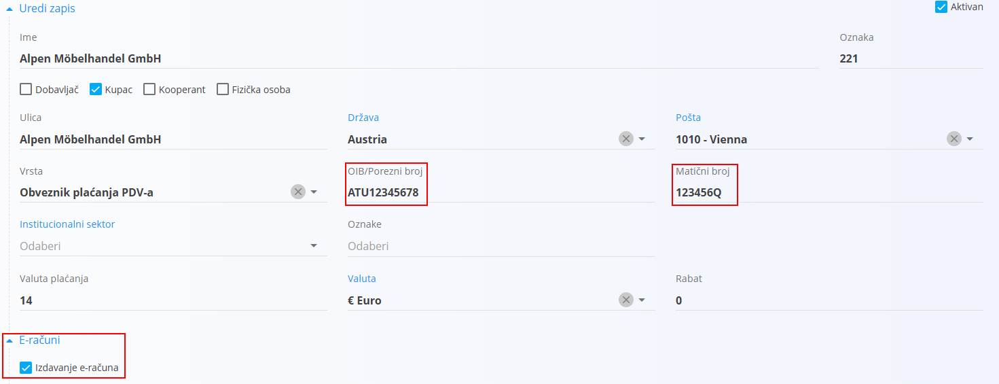
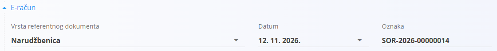
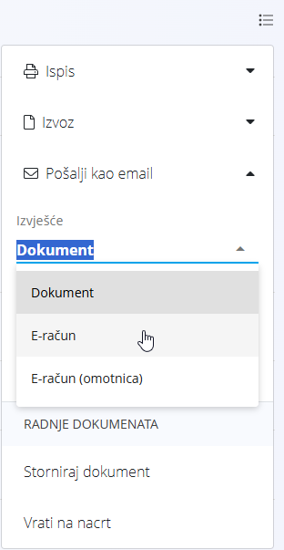
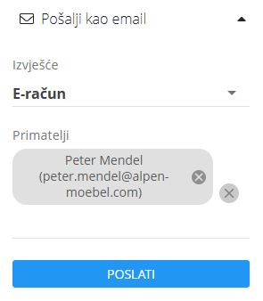

<!-- app_route: /management/contacts/companies -->
<!-- app_label: Poslovni imenik -->
<!-- canonical_source_url: https://github.com/Tom-PIT/Connected.Docs/blob/main/hr/Zajednicko/Koncepti/ERacuni.md -->
<!-- canonical_source_title: E-računi -->

# E-računi

**E-račun** je strukturirana elektronička verzija računa koju sustav kupca može automatski obraditi. U aplikaciji se e-računi generiraju u slovenskom formatu **eSLOG** XML i mogu se izvesti iz izbornika objavljenog dokumenta.

E-račune generira servis za e-račune tvrtke Tom PIT, a ne sama aplikacija. Servis mora biti postavljen za vašu organizaciju prije nego što se e-računi mogu izvesti.

## Podržani dokumenti

E-račune možete izdavati iz sljedećih dokumenata:

- [**Izlazni računi**](../../Domene/Prodaja/Dokumenti/IzlazniRacuni.md)
- [**Odobrenja**](../../Domene/Prodaja/Dokumenti/Odobrenja.md)

## Preduvjeti

### Organizacija

| Zahtjev | Opis |
|---------|------|
| **Servis za e-račune** | Servis je postavljen za vašu organizaciju. Postavlja ga Tom PIT. Ako izvoz vrati pogrešku konfiguracije, obratite se podršci tvrtke Tom PIT. |
| **Matični broj** i **Porezni broj** | Unose se u postavkama [**Organizacije**](../../Domene/Sustav/Postavke/PostavkeSustava.md). |
| [**Bankovni račun organizacije**](../../Domene/Prodaja/Upravljanje/BankovniRacuniOrganizacije.md) | Odabire se na dokumentu. Koristi se kao račun za primanje uplate. |

### Kupac

Za kupca u [**Poslovnom imeniku**](../Upravljanje/PoslovniImenik.md) potrebno je unijeti sljedeće podatke:

| Zahtjev | Opis |
|---------|------|
| **E-računi** | Mora biti označen okvir **Izdavanje e-računa** u odjeljku **E-računi**. |
| **OIB/Porezni broj** | PDV identifikacijski broj kupca. |
| **Matični broj** | Matični broj tvrtke kupca. |
| [**Bankovni račun**](../Upravljanje/BankovniRacuni.md) | Najmanje jedan bankovni račun kupca. |

### Dokument

| Zahtjev | Opis |
|---------|------|
| **Odjeljak E-račun** | Sva polja u odjeljku **E-račun** moraju biti popunjena (vidi odjeljak Unos podataka za e-račun u nastavku). |
| **Oznaka svrhe** | Dokument mora imati oznaku svrhe odabranu iz vanjskih šifrarnika. Oznaka može imati najviše 4 znaka, na primjer ISO 20022 oznaku svrhe kao što su **SUPP** ili **GDSV**. |
| **Status** | Dokument mora biti objavljen. |

## Unos podataka za e-račun

Kada su e-računi uključeni za kupca, dokument sadrži dodatni odjeljak **E-račun**.

Odjeljak sadrži referencu na dokument koji je izdao kupac, na primjer njegovu narudžbu ili ugovor. Unesite podatke koje je dostavio kupac.

| Polje | Opis |
|-------|------|
| **Vrsta referentnog dokumenta** | Vrsta dokumenta kupca (obvezno). |
| **Datum** | Datum dokumenta kupca (obvezno). |
| **Oznaka** | Broj ili oznaka dokumenta kupca (obvezno). |

<!-- TODO: Croatian labels for the referenced document types are not confirmed; the list stays in English until a capture is available. -->

Dostupne vrste referentnih dokumenata:

- Contract
- Credit note
- Delivery note
- Issued invoice
- Object
- Proforma invoice
- Project
- Receive
- Sales order
- Supply order
- Tender

> [!NOTE]
> Dokument se ne može objaviti dok nisu popunjena sva polja u odjeljku **E-račun**.

> [!TIP]
> Ako su e-računi za kupca uključeni tek nakon objave dokumenta ili su podaci o e-računu pogrešno uneseni, odaberite **Vrati na nacrt** u izborniku, ispravite polja u odjeljku **E-račun** i ponovno objavite dokument.

## Izvoz i slanje e-računa

E-račun možete preuzeti ili poslati e-poštom iz [izbornika](RadnjeIzbornika.md) objavljenog dokumenta. Za obje radnje u polju **Izvješće** odaberite što želite izvesti ili poslati:

| Izvješće | Sadržaj |
|----------|---------|
| **Dokument** | PDF verzija dokumenta. |
| **E-račun** | E-račun u eSLOG 2.0 XML formatu, na primjer `IIN-2026-00000013.xml`. |
| **E-račun (omotnica)** | ZIP datoteka s cijelim paketom e-računa (vidi dolje). |

> [!NOTE]
> Opcije **E-račun** i **E-račun (omotnica)** dostupne su samo za objavljene dokumente kupaca s uključenim e-računima.

### Izvoz e-računa

1. Otvorite objavljeni dokument.
2. Otvorite **Izbornik** u gornjem desnom kutu i proširite **Izvoz**.
3. U polju **Izvješće** odaberite **E-račun** ili **E-račun (omotnica)**.
4. Kliknite **Izvoz**.

### Slanje e-računa e-poštom

1. Otvorite objavljeni dokument.
2. Otvorite **Izbornik** u gornjem desnom kutu i proširite **Pošalji kao email**.
3. U polju **Izvješće** odaberite **E-račun** ili **E-račun (omotnica)**.
4. U polju **Primatelji** odaberite jednog ili više primatelja. Popis prikazuje kontakte kupca: primarni kontakt iz [Poslovnog imenika](../Upravljanje/PoslovniImenik.md) i kontakte iz šifrarnika [Kontakti](../Upravljanje/Kontakti.md).
5. Kliknite **Poslati**.

Odabrana datoteka šalje se kao privitak e-poruke i nazvana je prema šifri dokumenta, na primjer `IIN-2026-00000014`.

### Sadržaj omotnice

ZIP datoteka izvezena ili poslana s **E-račun (omotnica)** sadrži:

| Datoteka | Opis |
|----------|------|
| `envelope.env` | Omotnica s podacima pošiljatelja i primatelja (naziv, adresa, PDV ID, bankovni račun i BIC) te podacima o plaćanju. Banke je koriste za dostavu e-računa primatelju. |
| `<šifra dokumenta>.xml` | E-račun u eSLOG 2.0 XML formatu. |
| `<šifra dokumenta>.pdf` | PDF verzija dokumenta. |

ZIP datoteka nazvana je prema šifri dokumenta, na primjer `IIN-2026-00000013.zip`.

> [!TIP]
> Koristite **E-račun** kada kupac treba samo datoteku e-računa. Koristite **E-račun (omotnica)** kada e-račun šaljete putem bankovne razmjene e-računa, na primjer putem internetskog bankarstva.

## Rješavanje problema

Ako neki obavezni podatak nedostaje, izvoz se zaustavlja i poruka navodi koji podatak nedostaje, na primjer *Customer does not have a registration number set*. Unesite nedostajući podatak (vidi odjeljak Preduvjeti) i ponovite izvoz.

Ako je dokument objavljen prije nego što su e-računi uključeni za kupca, ne sadrži podatke o e-računu i ne može se izvesti kao e-račun. Odaberite **Vrati na nacrt**, popunite odjeljak **E-račun** i ponovno objavite dokument.

Ostale poruke:

| Poruka | Uzrok | Rješenje |
|--------|-------|----------|
| *E-invoice data must be filled in, because e-invoices are issued for this customer.* | Odjeljak **E-račun** na dokumentu nije potpun. | Popunite sva polja u odjeljku **E-račun** i ponovno objavite. |
| *An invalid request URI was provided. Either the request URI must be an absolute URI or BaseAddress must be set.* | Servis za e-račune nije postavljen za vašu organizaciju. | Obratite se podršci tvrtke Tom PIT. |
