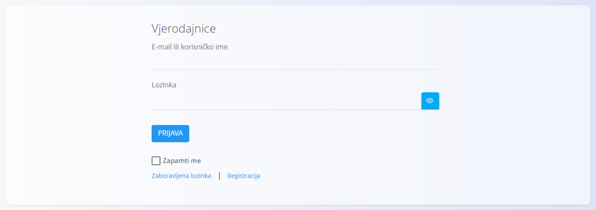
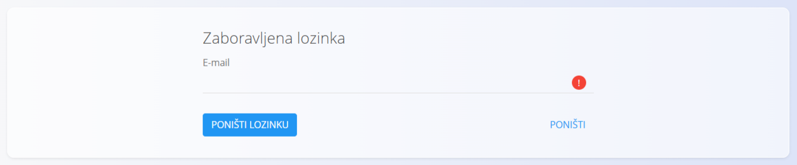
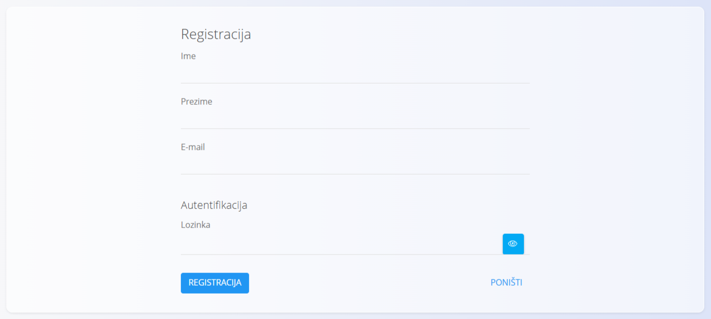

<!-- app_route: /login -->
<!-- app_label: Login -->
<!-- canonical_source_url: https://github.com/Tom-PIT/Connected.Docs/blob/main/hr/Zajednicko/UI/Prijava.md -->
<!-- canonical_source_title: Prijava -->

# Prijava

Zaslon **Prijava** služi za pristup aplikaciji pomoću korisničkih vjerodajnica.

## Vjerodajnice

Za prijavu unesite:

- **E-mail ili korisničko ime**
- **Lozinka**

Kliknite **Prijava** za pristup aplikaciji.

### Dodatne mogućnosti

- **Zapamti me** – zadržava korisnika prijavljenim na trenutnom uređaju
- **Zaboravljena lozinka** – otvara zaslon za poništavanje lozinke
- **Registracija** – otvara zaslon za registraciju (ako je omogućena)

## Poništavanje lozinke

Ako ste zaboravili lozinku, kliknite **Zaboravljena lozinka**.

Unesite svoju adresu e-pošte u polje **E-mail** i kliknite **Poništi lozinku**.

Na adresu e-pošte primit ćete upute za postavljanje nove lozinke.

## Registracija

Ako je registracija omogućena, korisnici mogu stvoriti novi korisnički račun.

Za registraciju unesite:

- **Ime**
- **Prezime**
- **E-mail**
- **Lozinka**

Kliknite **Registracija** kako biste stvorili korisnički račun.

> [!NOTE]
> Dostupnost registracije ovisi o konfiguraciji sustava.