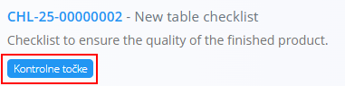
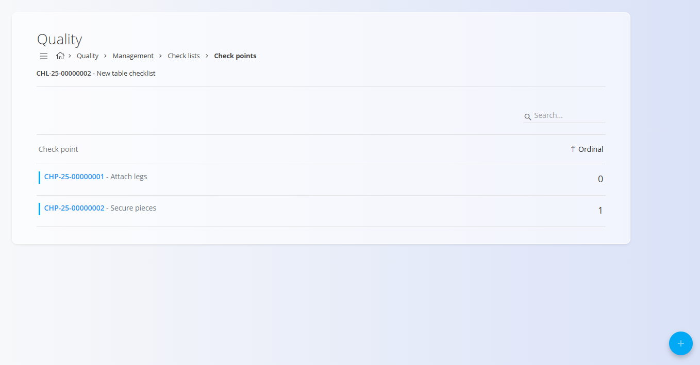
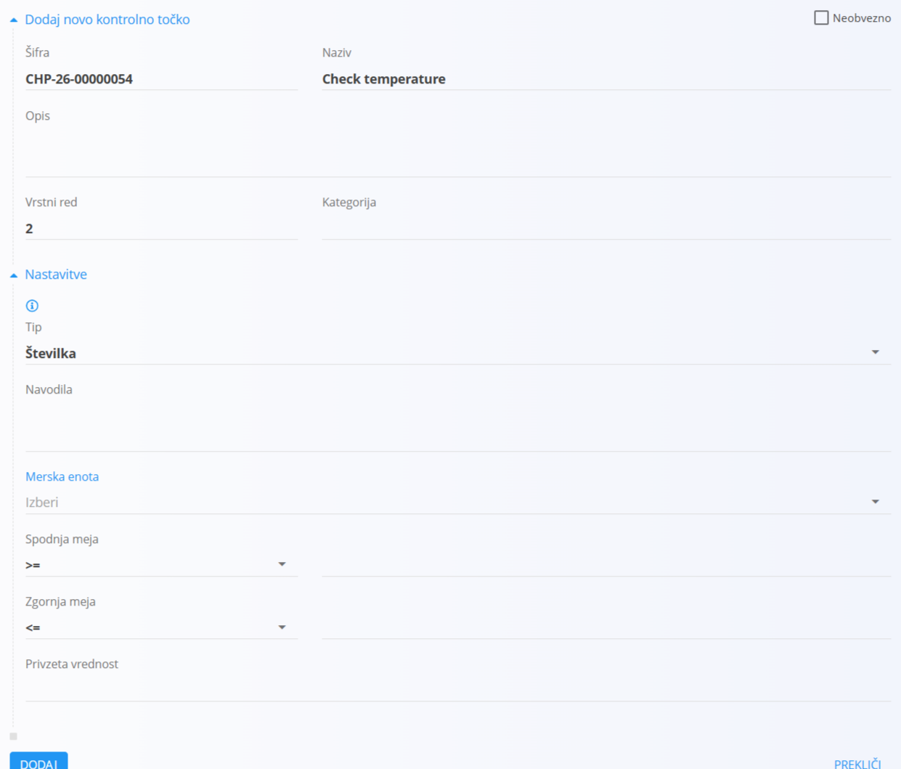
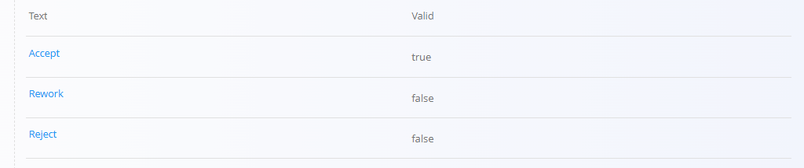
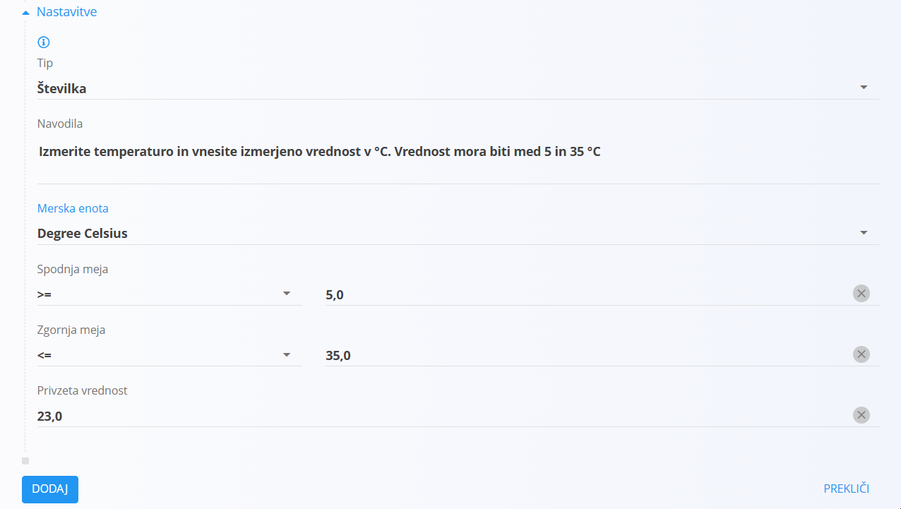
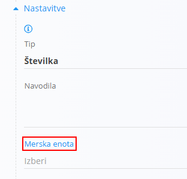

<!-- app_route: /management/check-lists -->
<!-- app_label: Kontrolne liste -->
<!-- canonical_source_url: https://tom-pit.github.io/Connected.Docs/sl/Domene/Kvaliteta/Upravljanje/KontrolneTocke/ -->
<!-- canonical_source_title: Kontrolne točke -->

# Kontrolne točke

Kontrolne točke pripadajo posamezni **[Kontrolni listi](KontrolneListe.md)** in določajo posamezne korake, kontrole ali preverjanja, ki jih morajo izvajalci opraviti med proizvodnjo ali preverjanjem kakovosti. Zagotavljajo dosledno izvajanje procesa ter omogočajo strukturirano zbiranje podatkov za sledenje, revizije in poročanje.

Za dostop do kontrolnih točk pojdite na **Kakovost / Upravljanje / Kontrolne liste** v [navigaciji](../../../Skupno/UI/Navigacija.md) in pri želenem kontrolnem seznamu kliknite **Kontrolne točke**.

> [!TIP]
> Za celovit prikaz si oglejte video vodič **[Kontrolne točke kakovosti](https://www.youtube.com/watch?v=EB7WktBCFC4)**.

> [!TIP]
> Za praktičen primer ustvarjanja kontrolne liste in različnih tipov kontrolnih točk si oglejte [**Kako ustvariti kontrolno listo kakovosti**](KontrolniListUstvarjanje.md).

## Shema

| Polje | Opis |
|------|------|
| [**Šifra**](../../../Skupno/UI/SifreDokumentov.md) | Sistemsko generiran enolični identifikator kontrolne točke. |
| **Naziv** | Naziv kontrolne točke (obvezno). |
| **Opis** | Dodatne podrobnosti ali kontekst kontrolne točke. |
| **Vrstni red** | Številka, ki določa zaporedje kontrolne točke znotraj kontrolnega seznama. |
| **Kategorija** | Neobvezna razvrstitev za združevanje ali filtriranje kontrolnih točk. |
| **Neobvezno** | Določa, ali je kontrolno točko dovoljeno preskočiti med izvajanjem. |
| **Tip** | Določa vrsto vnosa izvajalca: • **Besedilo** – prosti besedilni vnos • **[Označi](#tip-oznaci)** – potrditveno polje (da / ne) • **Priponka** – zahteva nalaganje datoteke (slika, PDF …) • **[Seznam](#tip-seznam)** – izbor ene ali več vrednosti s seznama • **[Številka](#tip-stevilka)** – številčni vnos |
| **Navodila** | Dodatna navodila, prikazana izvajalcu med izvajanjem kontrole. |

## Seznam kontrolnih točk

Seznam prikazuje vse kontrolne točke, povezane z izbranim kontrolnim seznamom, razvrščene po **Vrstnem redu**.

Za iskanje uporabite iskalno polje, ki omogoča filtriranje po nazivu ali šifri.

## Dodati novo kontrolno točko

1. Kliknite **[akcijski gumb](../../../Skupno/UI/AkcijskiGumb.md)** v spodnjem desnem kotu.  
2. Izpolnite polja, opisana v shemi:  
   - **Naziv** (obvezno)  
   - **Opis** (neobvezno)  
   - **Vrstni red** – določa zaporedje v kontrolnem seznamu  
   - **Kategorija** – po potrebi  
   - **Neobvezno** – označite, če kontrolna točka ni obvezna  
   - **Tip** – izberite vrsto vnosa  
   - **Navodila** – navodila za izvajanje kontrole  

   

3. Kliknite **Dodaj**, da shranite kontrolno točko.

> [!NOTE]
> Nekaj posebnosti se lahko pojavijo glede na izbran **Tip**. Glejte [Posebnosti glede na tip](#posebnosti-glede-na-tip)

## Urediti kontrolne točke

1. Izberite kontrolno točko s seznama.  
2. Spremenite poljubno polje, vključno s **Tipom**, **Kategorijo** ali **Navodili**.  
3. Kliknite **Shrani**.

## Izbrisati kontrolne točke

Kontrolne točke je mogoče brisati, razen če je to omejeno z nastavitvami delovnega toka. Za odstranitev odprite kontrolno točko in kliknite **Izbriši**.

## Posebnosti glede na tip

Določena polja se prikažejo ali postanejo obvezna glede na izbran **Tip**. Za vse tipe potrditveno polje **Neobvezno** določa, ali mora izvajalec kontrolno točko izpolniti.

### Tip: Označi

Tip **Označi** uporabite za korak, ki ga izvajalec potrdi s kljukico, na primer »Varovalo je nameščeno« ali »Nalepka je pritrjena«. Izvajalec označi potrditveno polje ob **Potrditvenem besedilu**, s čimer je kontrolna točka opravljena. Potrditveno besedilo naj jasno pove, kaj izvajalec potrjuje.

Pri izbiri tipa **Označi** se prikaže dodatno polje:

| Atribut | Tip | Opis |
|----------|------|------|
| **Potrditveno besedilo** | Text | Besedilo, prikazano ob potrditvenem polju. |

### Tip: Seznam

Tip **Seznam** uporabite, kadar izvajalec izbira med vnaprej določenimi možnostmi, na primer »Videz: dober / opraskan / poškodovan«. Nastavite **Število veljavnih vrednosti** na **Ena**, če je mogoče izbrati le eno možnost, ali na **Več**, če lahko velja več možnosti. Možnost, označena kot **Veljavno**, predstavlja sprejemljiv rezultat. Pri kontroli kakovosti neveljavna možnost pomeni težavo, na primer opraskano površino.

Pri izbiri tipa **Seznam** se prikažejo dodatne nastavitve:

| Atribut | Tip | Opis |
|----------|------|------|
| **Število veljavnih vrednosti** | Dropdown | Določa ali je možna izbira **Ena** ali **Več** vrednosti. Če je **Ena**, je mogoče izbrati samo eno vrednost. Če je **Več**, je mogoče izbrati več vrednosti. |

Uporabnik lahko dodaja vrednosti seznama:

- Klik na **Dodaj novo vrednost** odpre vnos:
  - **Besedilo** - polje za vnos besedila, ki predstavlja vrednost seznama
  - **Veljavno** (checkbox) - označuje, ali je ta vrednost veljavna ali ne. To je uporabno za kontrole kakovosti, kjer so določeni pogoji lahko označeni kot neveljavni, za **eno** vrsto je lahko veljavna samo ena vrednost.

- Klik na **Dodaj** shrani vrednost v seznam

Dodane vrednosti so prikazane v tabeli:
- **Besedilo**
- **Veljavno**

### Tip: Številka

Tip **Številka** uporabite, kadar mora izvajalec vnesti številčno vrednost, na primer odčitek ali meritev. Primer: kontrolna točka »Vnesite temperaturo« z mersko enoto °C, privzeto vrednostjo 23, **Spodnjo mejo** >= 5 in **Zgornjo mejo** <= 35. Izvajalec vpiše izmerjeno temperaturo, kontrolni list pa jo sprejme le, če je znotraj mej.

Pri izbiri tipa **Številka** se prikažejo dodatna polja:

| Atribut | Tip | Opis |
|----------|------|------|
| **Merska enota** | Dropdown | Izbira merske enote. |
| **Spodnja meja** | Dropdown in število | Spodnja meja dovoljenih vrednosti. Izberite **>=** (vrednost na meji je dovoljena) ali **>** (dovoljene so samo vrednosti nad mejo), nato vnesite vrednost meje. |
| **Privzeta vrednost** | Number | Privzeta vrednost za kontrolno točko. |
| **Zgornja meja** | Dropdown in število | Zgornja meja dovoljenih vrednosti. Izberite **<=** (vrednost na meji je dovoljena) ali **<** (dovoljene so samo vrednosti pod mejo), nato vnesite vrednost meje. |

Na primer, če je **Spodnja meja** nastavljena na **>= 5**, je vrednost 5 dovoljena. Pri **> 5** vrednost 5 ni dovoljena, najmanjša dovoljena vrednost pa je nad 5.

> [!NOTE]
> Na voljo je povezava do zaslona za upravljanje [**Merske enote**](../../../Skupno/Upravljanje/MerskeEnote.md), kjer lahko dodajate ali urejate merske enote.
>
> 

### Tip: Priponka

Tip **Priponka** uporabite, kadar mora izvajalec priložiti dokaz, na primer fotografijo končnega izdelka ali PDF testnega certifikata. Izvajalec priloži datoteko med izpolnjevanjem kontrolnega lista. Če **Neobvezno** ni označeno, kontrolne točke ni mogoče zaključiti, dokler ni priložena datoteka.

### Tip: Besedilo

Tip **Besedilo** uporabite, kadar mora izvajalec vpisati prosto besedilno opombo, na primer opis napake ali ime pregledovalca serije. Izvajalec vpiše odgovor v polje, ta pa se shrani skupaj s kontrolnim listom.