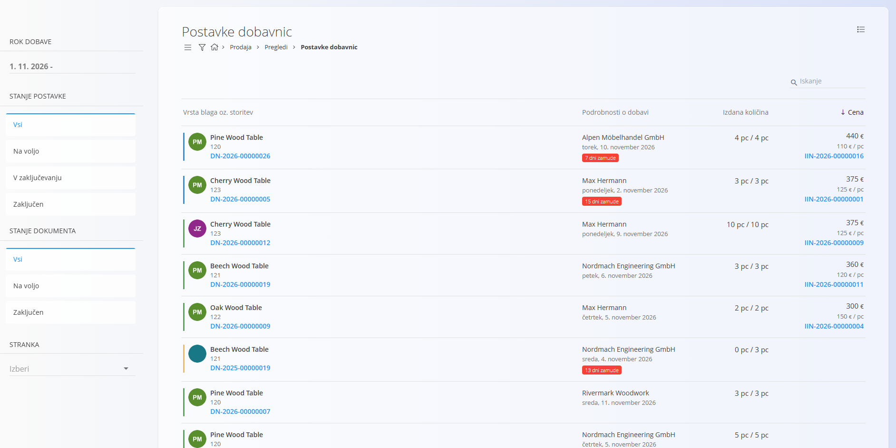

<!-- app_route: /sales/views/delivery-note-details -->
<!-- app_label: Postavke dobavnic -->
<!-- canonical_source_url: https://tom-pit.github.io/Connected.Docs/sl/Domene/Prodaja/Pregledi/PostavkeDobavnic/ -->
<!-- canonical_source_title: Postavke dobavnic -->

# Postavke dobavnic

Pogled **Postavke dobavnic** omogoča hiter pregled stanja dobav. Prikazuje postavke iz [**dobavnic**](../Dokumenti/Dobavnice.md) po vrsticah, tako da vidite, koliko je že izdanega, ter katere postavke so bile zaračunane in po kateri ceni.

Ta pogled je izključno analitičen — **ne omogoča** ustvarjanja ali spreminjanja dobavnic.

Za dostop do tega pregleda pojdite na **Prodaja / Pregledi / Postavke dobavnic** v [navigaciji](../../../Skupno/UI/Navigacija.md).

## Seznam postavk dobavnic

Vsaka vrstica v seznamu predstavlja **eno posamezno postavko dobavnice**, vključno z naslednjimi podatki:

- **Vrsta blaga oz. storitev** – Sredstvo, ki je dobavljeno, z njegovo šifro in nazivom. Šifra dobavnice je prikazana s povezavo do [**dobavnice**](../Dokumenti/Dobavnice.md).  
- **Podrobnosti o dobavi** – Stranka in datum dobave.  
- **Izdana količina** – Število že izdanih enot, ki mu sledi skupna količina na dobavnici, npr. **0 pc / 3 pc**.  
- **Cena** – Cena iz računa. Številka računa je prikazana s povezavo do računa. Cena je prazna za dobavnice, ki še niso zaračunane.

## Filtri

Leva stranska vrstica vsebuje naslednje filtre:

- **Rok dobave** – Izbira časovnega obdobja dobave.  
- **Stanje postavke** – Filtrira postavke glede na napredek pošiljanja.  
  - *Vsi*  
  - *Na voljo* – Nobena postavka ni bila poslana.  
  - *V zaključevanju* – Nekatere postavke so bile poslane, ne vse. Npr. 1 od 4 postavk.  
  - *Zaključen* – Vse postavke so bile poslane.  
- **Stanje dokumenta** – Prikazuje stanje zaključenosti dobavnice.  
  - *Vsi*  
  - *Na voljo* – Dobavnica ni zaključena.  
  - *Zaključen* – Dobavnica je zaključena in shranjena.  
- **Stranka** – Filtriranje po stranki.

## Zamudne dobavnice

Pod datumom dobave se prikaže rdeča oznaka, ki kaže, koliko dni je dobava zamujena, npr. **15 dni zamude**. Oznaka se prikaže, ko je datum dobave, zapisan na dobavnici, že minil, in šteje dni od tega datuma. Zaključene dobavnice oznake ne prikazujejo.

## Namen

Pogled **Postavke dobavnic** je uporaben za:

- Pregled, katere dobavljene postavke so bile zaračunane in po kateri ceni  
- Sledenje številki računa za vsako dobavljeno postavko  
- Pregled zgodovine dobav za stranko, postavko za postavko  

Ta pregled dopolnjuje pregled **[Poročila dobavnic](PorocilaDobavnic.md)**, saj se osredotoča na **posamezne postavke**, ne na skupne vrednosti po stranki.

## Meni

Meni omogoča dodatna dejanja, ki so na voljo na tej strani.

Na voljo je dejanje **Izvoz**. V oknu za izvoz:

- **Poročilo** – izberite **Postavke**.  
- **Format datoteke** – izberite **CSV**.

Nato izberite **IZVOZ**.

Za podrobnosti o dejanjih menija glejte [**Dejanja menija**](../../../Skupno/Koncepti/MeniDejanja.md).
