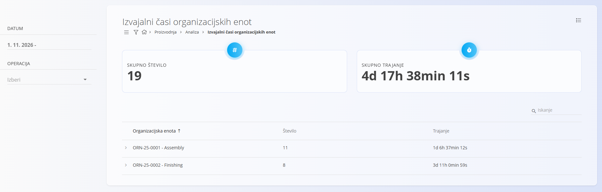
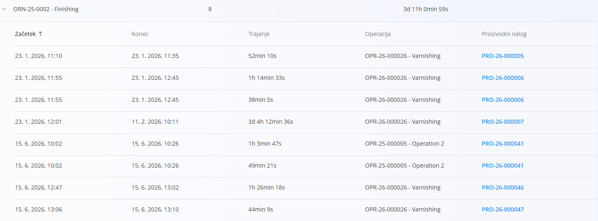

<!-- app_route: /production/analytics/organization-unit-running-times -->
<!-- app_label: Izvajalni časi organizacijskih enot -->
<!-- canonical_source_url: https://tom-pit.github.io/Connected.Docs/sl/Domene/Proizvodnja/Analiza/IzvajalniCasiOrganizacijskihEnot/ -->
<!-- canonical_source_title: Izvajalni časi organizacijskih enot -->

# Izvajalni časi organizacijskih enot

Pogled **Izvajalni časi organizacijskih enot** prikazuje, koliko izvajalnih časov je bilo zabeleženih za posamezno organizacijsko enoto in koliko so trajali skupaj. Pogled uporabite, če želite ugotoviti, katere organizacijske enote imajo v izbranem obdobju največ zabeleženega izvajalnega časa.

Ta pogled je izključno analitičen in **ne omogoča** ustvarjanja ali spreminjanja operacij.

Za dostop do tega pogleda pojdite na **Proizvodnja / Analiza / Izvajalni časi organizacijskih enot** v [navigaciji](../../../Skupno/UI/Navigacija.md).

## Skupne vrednosti

Na vrhu sta dve ploščici, ki prikazujeta skupne vrednosti za trenutno izbor:

- **Skupno število** – Število zabeleženih izvajalnih časov.
- **Skupno trajanje** – Skupno trajanje vseh zabeleženih izvajalnih časov, npr. **4d 17h 38min 11s**.

## Filtri

Leva stranska vrstica vsebuje naslednja filtra:

- **Datum** – Izberite časovno obdobje, za katero želite prikazati izvajalne čase.
- **Operacija** – Izberite operacijo, ki jo želite pregledati.

## Seznam organizacijskih enot

Seznam prikazuje zabeležene izvajalne čase, združene po **organizacijski enoti**. Za vsako organizacijsko enoto prikazuje:

- **Organizacijska enota** – Šifra in naziv organizacijske enote.
- **Število** – Število zabeleženih izvajalnih časov za to organizacijsko enoto.
- **Trajanje** – Skupno trajanje teh izvajalnih časov.

Organizacijsko enoto poiščite z iskalnim poljem nad seznamom. Vsako vrstico lahko razširite s puščico na levi. Razširjena vrstica prikaže vsak zabeleženi izvajalni čas za to organizacijsko enoto, s temi stolpci:

- **Začetek** – Datum in čas začetka izvajalnega časa.
- **Konec** – Datum in čas konca izvajalnega časa.
- **Trajanje** – Trajanje tega izvajalnega časa.
- **Operacija** – Operacija, ki je bila izvedena.
- **Proizvodni nalog** – Proizvodni nalog, kateremu izvajalni čas pripada, prikazan s povezavo.

## Meni

Meni vsebuje dejanje **Pavziraj vse operacije**. Pavzirajte vse operacije proizvodnih nalogov, ki so trenutno v izvajanju. Prikaže se okno, v katerem dejanje odobrite.

Za podrobnosti o dejanjih menija glejte [**Dejanja menija**](../../../Skupno/Koncepti/MeniDejanja.md).
