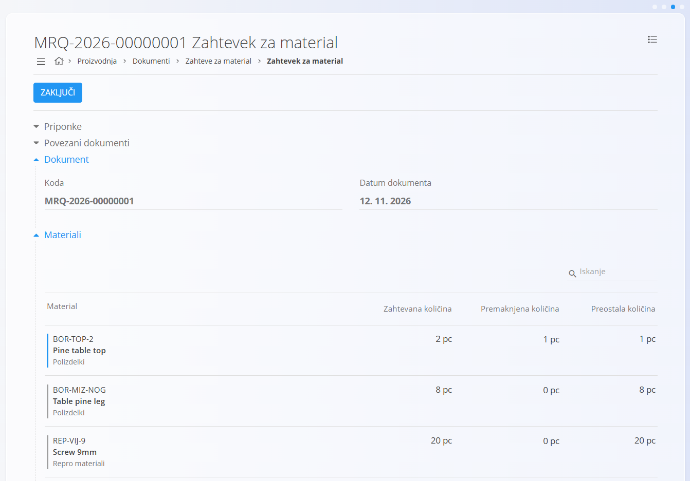
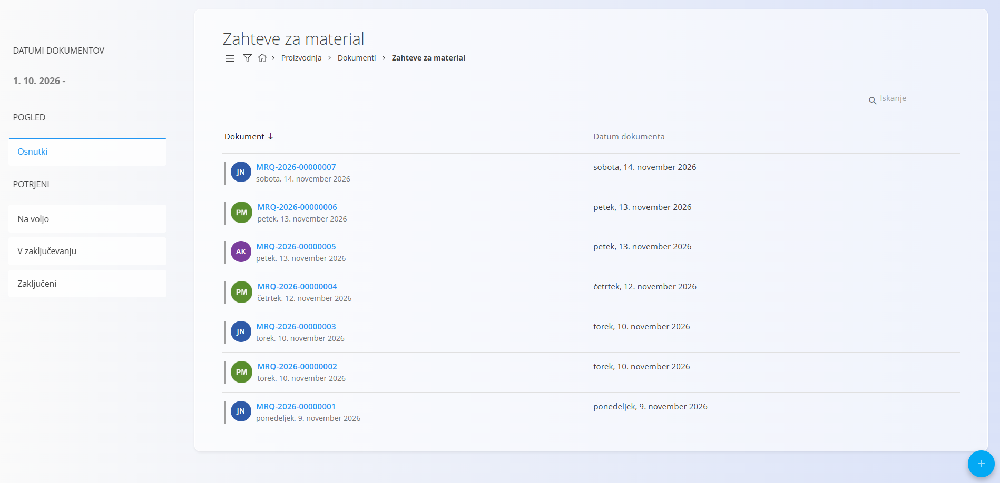
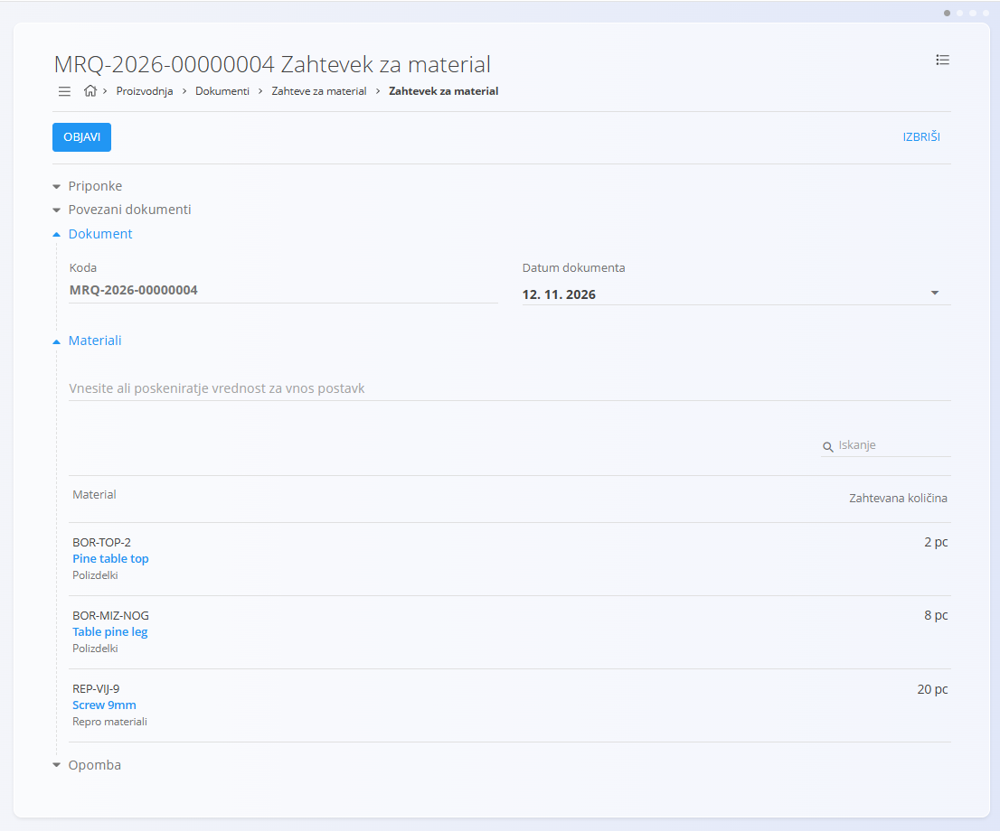
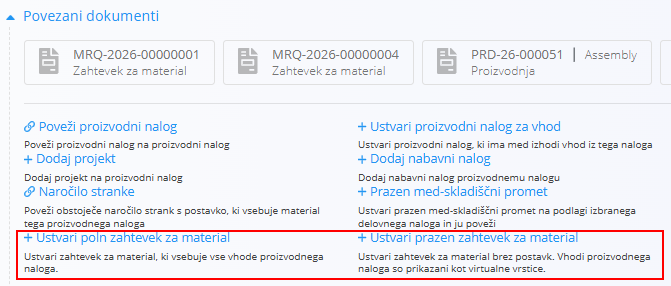
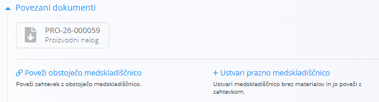

<!-- app_route: /logistics/documents/material-requests -->
<!-- app_label: Zahteve za material -->
<!-- canonical_source_url: https://tom-pit.github.io/Connected.Docs/sl/Domene/Proizvodnja/Dokumenti/ZahteveZaMaterial/ -->
<!-- canonical_source_title: Zahteve za material -->

# Zahteve za material

**Zahtevek za material** zahteva od skladišča materiale. Planer ali vodja izmene navede materiale in količine, ki jih potrebuje proizvodno območje. Skladišče nato materiale premakne z enim ali več dokumenti [**Med-skladiščni promet**](../../Logistika/Dokumenti/MedSkladiscniPromet.md).

Zahtevek za material ne spremeni zaloge. Materiale premaknejo šele dokumenti med-skladiščnega prometa, ustvarjeni iz zahtevka.

Za dostop do strani **Zahteve za material** pojdite na **Proizvodnja / Dokumenti / Zahteve za material** v [navigaciji](../../../Skupno/UI/Navigacija.md).

## Kako zahtevki za material sodijo v proizvodni proces

1. [**Proizvodni nalog**](ProizvodniNalogi.md) določa materiale, ki jih potrebuje.
2. Iz proizvodnega naloga ustvarite zahtevek za material z **Ustvari poln zahtevek za material** ali **Ustvari prazen zahtevek za material**.
3. Skladišče z enim ali več dokumenti med-skladiščnega prometa poveže zahtevek in premakne materiale.

## Shema

<strong>Dokument</strong>

| Polje | Opis |
|------|------|
| [**Koda**](../../../Skupno/UI/SifreDokumentov.md) | Sistemsko generiran enolični identifikator zahtevka za material. |
| **Datum dokumenta** | Datum zahtevka. |
| **Opomba** | Dodatne opombe za skladišče. |
| **Priponke** | Datoteke, povezane z zahtevkom. |

<strong>Materiali</strong>

| Polje | Opis |
|------|------|
| [**Material**](../../Sredstva/Materiali/README.md) | Zahtevani material. |
| **Koda** | Koda materiala. Vnesite ali poskenirajte kodo, da dodate material. |
| **Zahtevana količina** | Zahtevana količina v enoti materiala (na primer kos). |
| **Premaknjena količina** | Količina, ki so jo že premaknili dokumenti med-skladiščnega prometa, ustvarjeni iz zahtevka. Izpolni se samodejno. |
| **Preostala količina** | Količina, ki jo je še treba premakniti. Izpolni se samodejno. |

> [!NOTE]
> Postavke ne vsebujejo cen in davkov. Zahtevek za material je zahteva za zalogo, ne finančni dokument.

## Upravljanje

### Stanja dokumenta

Zahtevek za material je v enem od štirih stanj:

- **Osnutki** – zahtevek se pripravlja. Osnutke je mogoče urediti in izbrisati.
- **Na voljo** – zahtevek je objavljen, skladišče pa lahko ukrepa.
- **V zaključevanju** – skladišče zahtevek dokončuje. Zahtevek je delno premaknjen, preostala količina pa ostane na zahtevku.
- **Zaključeni** – zahtevek je dokončan. Z gumbom **Zaključi** zahtevek preide v to stanje, tudi če materiali še niso vsi premaknjeni.

### Pogled seznama

Seznam zahtevkov za material prikazuje vse dokumente, razvrščene po stanjih v levi stranski vrstici: **Osnutki**, **Na voljo**, **V zaključevanju** in **Zaključeni**. Zadnji trije so zbrani pod **Potrjeni**. Dokument poiščete z iskalno vrstico ali filtrirate seznam z levo stransko vrstico. Filtri delujejo enako kot na strani [**Prevzemi**](../../Logistika/Dokumenti/Prevzemi.md). Filtra po skladišču še ni.

## Akcije

### Ustvarjanje zahtevka za material

1. Izberite [akcijski gumb](../../../Skupno/UI/AkcijskiGumb.md) in izberite **Dodaj novo**.
2. V razdelku **Materiali** vnesite ali poskenirajte kodo ali ime materiala, da ga dodate. Ponovite za vsak material, ki ga potrebujete, in za vsakega vnesite zahtevano količino.
3. Po potrebi vnesite **Opombo** ali priložite datoteke za skladišče.
4. Izberite **Shrani**, da dokument shranite kot osnutek.

<!-- TODO: Potrdite slovenske oznake za akcije Dodaj novo in Shrani. -->

Zahtevek se prikaže v stanju **Osnutki**. Preden ga pošljete skladišču, ga lahko natisnete ali izvozite iz [menija](#meni).

### Ustvarjanje zahtevka za material iz proizvodnega naloga

Zahtevek za material lahko ustvarite neposredno iz [**proizvodnega naloga**](ProizvodniNalogi.md). V razdelku **Povezani dokumenti** naloga izberite eno od naslednjih možnosti:

- **Ustvari poln zahtevek za material** ustvari zahtevek za material, ki vsebuje vse vhode proizvodnega naloga.
- **Ustvari prazen zahtevek za material** ustvari zahtevek brez postavk. Vhodi proizvodnega naloga so prikazani kot virtualne vrstice.

Za poln zahtevek sistem prepiše vse vhode naloga. Za prazen zahtevek dodajte vrstice, ki jih potrebujete. Materiale lahko pred shranjevanjem spremenite.

Zahtevek za material je povezan s proizvodnim nalogom. Na zahtevku vidite:

- **zahtevano količino** in
- **premaknjeno količino** z dokumenti med-skladiščnega prometa, ustvarjenimi iz tega zahtevka.

To je pomembno, ker lahko en zahtevek izpolnite v več prenosih.

### Urejanje zahtevka za material

Urejati je mogoče samo osnutke. Spremenite lahko datum dokumenta in materiale, dodate lahko nove materiale ter spremenite podrobnosti, na primer **zahtevano količino**.

#### Povezani dokumenti

Razdelek povezanih dokumentov omogoča ustvarjanje dokumentov, ki sledijo ali so povezani z zahtevkom. Prikazuje tudi že povezane dokumente.

Za podrobnosti o povezovanju dokumentov, sledljivosti in ustvarjanju povezanih dokumentov glejte [**Povezani dokumenti**](../../../Skupno/Koncepti/PovezaniDokumenti.md).

### Brisanje zahtevka za material

Osnutke zahtevkov za material je mogoče izbrisati na zaslonu za urejanje. Če želite iz osnutka odstraniti en sam material, ga izberite v razdelku **Materiali** in izberite **Izbriši** v oknu za urejanje postavke.

<!-- TODO: Potrdite slovensko oznako gumba Izbriši v oknu za urejanje postavke. -->

### Vrnitev zahtevka v osnutek

Z akcijo **Povrni v osnutek** lahko spremenite zahtevek, ki je na voljo, na primer da popravite količino. Zahtevek se nato vrne v stanje **Osnutki**.

<!-- TODO: Potrdite slovensko oznako akcije Povrni v osnutek in stanja, v katerih je na voljo. -->

### Ustvarjanje med-skladiščnega prometa iz zahtevka za material

Ko skladišče obdela zahtevek, med-skladiščni promet poveže z njim. V razdelku **Povezani dokumenti** zahtevka izberite eno od naslednjih možnosti:

- **Ustvari prazno medskladiščnico** ustvari med-skladiščni promet brez materialov in ga poveže z zahtevkom. Postavke zahtevka so navedene v dokumentu pod skupino **Postavke zahtevka še niso prenesene**.
- **Poveži obstoječo medskladiščnico** poveže zahtevek z med-skladiščnim prometom, ki že obstaja.

- Izberete **končno skladišče**. Če je organizacijska enota, ki izvaja nalog, v svojih podatkih povezana s skladiščem, se končno skladišče izbere samodejno.
- Z objavo dokumenta med-skladiščnega prometa se zaloga premakne.

Za premik samo dela materialov glejte [**Med-skladiščni promet**](../../Logistika/Dokumenti/MedSkladiscniPromet.md).

<!-- TODO: Dodajte razdelek o premiku dela zahtevka na strani Med-skladiščni promet. -->

### Primer: premik polovice naloga v dveh delih

1. Proizvodni nalog potrebuje materiale za celoten zagon, skladišče pa lahko premakne le del naloga naenkrat.
2. Na proizvodnem nalogu izberite **Ustvari poln zahtevek za material**. Zahtevek se odpre kot osnutek.
3. Vodja izmene zahtevek pregleda in ga objavi.
4. V ponedeljek skladišče iz zahtevka ustvari dokument med-skladiščnega prometa in premakne približno 50 % materialov v proizvodnjo.
5. V sredo skladišče iz istega zahtevka ustvari drug dokument med-skladiščnega prometa in premakne preostanek.

## Meni

Meni ponuja dodatne akcije, ki so na voljo na tej strani.

Razpoložljive akcije:

- **Natisni**
- **Izvoz v PDF**
- **Povrni v osnutek** (samo za zahtevke na voljo) vrne zahtevek v stanje **Osnutki**.
- **Ponovno aktiviraj** (samo za zaključene zahtevke) vrne zahtevek v prejšnje stanje, **V zaključevanju** ali **Na voljo**.

<!-- TODO: Potrdite slovenske oznake akcij v meniju (Natisni, Izvoz v PDF, Povrni v osnutek, Ponovno aktiviraj). -->

Za podrobnosti o akcijah v meniju glejte [**Meni dejanja**](../../../Skupno/Koncepti/MeniDejanja.md).
