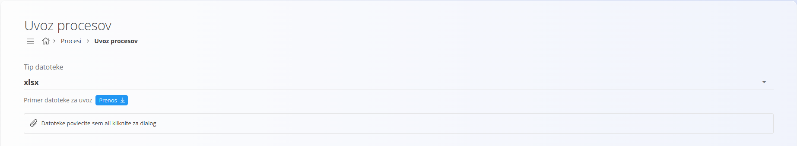
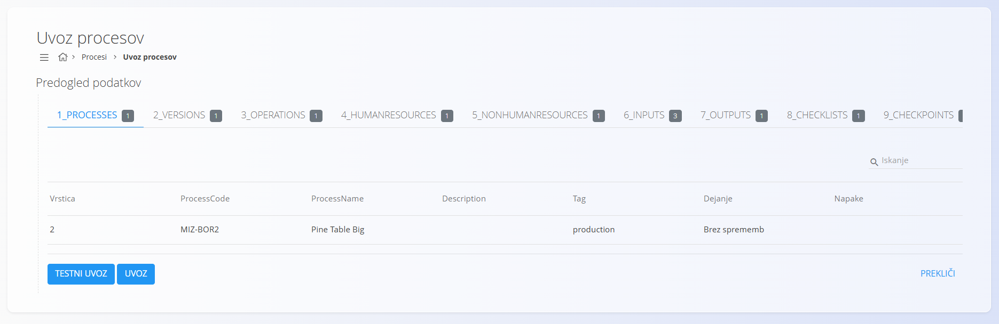
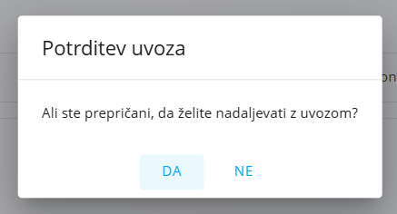
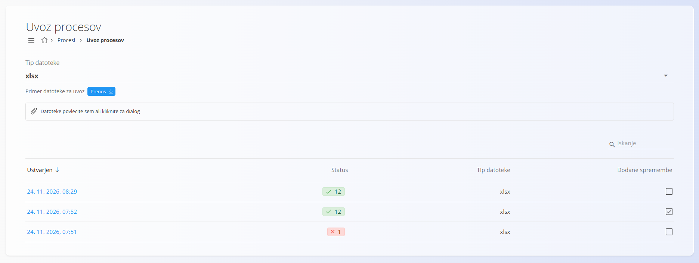
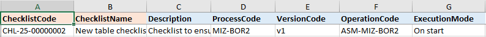

<!-- app_route: /management/processes/import -->
<!-- app_label: Uvoz procesov -->
<!-- canonical_source_url: https://tom-pit.github.io/Connected.Docs/sl/Domene/Proizvodnja/Upravljanje/UvozProcesov/ -->
<!-- canonical_source_title: Uvoz procesov -->

# Uvoz procesov

Ta dokument opisuje, kako lahko s datoteko Excel naenkrat dodate več procesov skupaj z njihovimi različicami, operacijami, viri, materiali in kontrolnimi listi. Uvoz se izvede na zaslonu [Procesi](Procesi.md).

> [!WARNING]
> **Predpogoji**
> Pred uvozom morajo v Connected že obstajati: materiali, delavci in stroji, kategorije virov, kompetence, delovna mesta in organizacijske enote. Uvoz jih ne ustvari.

Do uvoza pridete tako, da odprete seznam **Procesi**, kliknete [akcijski gumb](../../../Skupno/UI/AkcijskiGumb.md) in izberete **Uvoz**.

## Shema

Seznam uvozov prikazuje vse naložene datoteke.

| Polje | Opis |
|-------|------|
| **Ustvarjen** | Datum in čas nalaganja datoteke. Kliknite ga, da si ogledate rezultate. |
| **Status** | Število postavk v datoteki. Zelena kljukica pomeni, da je uvoz uspel. Rdeči križ prikazuje število postavk, ki niso uspele. |
| **Tip datoteke** | Format naložene datoteke. Podprta je samo datoteka **xlsx**. |
| **Dodane spremembe** | Označeno, ko so bile spremembe zapisane v Connected. Pri preskusnem ali neuspelem uvozu ni označeno. |

## Tip datoteke

Uvoz sprejema samo format **xlsx**. Kliknite **Prenos** ob **Primer datoteke za uvoz**, da prenesete predlogo. Predloga vsebuje zahtevane liste in stolpce v pravilnem vrstnem redu.

## Nalaganje datoteke

1. Izpolnite liste predloge (glejte [Predloga listov](#predloga-listov)).
2. Datoteko povlecite v območje za nalaganje ali kliknite območje in izberite datoteko. Odpre se **Predogled podatkov** z zavihkom za vsak list. Vsak zavihek prikazuje število vrstic, dejanje za vsako vrstico (na primer **Brez sprememb**) in morebitne napake.

   

3. Kliknite **Testni uvoz**, da preverite datoteko, ne da bi spremenili podatke.
4. Če preverjanje ne pokaže napak, kliknite **Uvoz**. V pogovornem oknu potrdite z **Da**.

   

## Rezultati uvoza

Vsak uvoz je naveden na seznamu uvozov. Kliknite datum v stolpcu **Ustvarjen**, da si ogledate rezultate in morebitne napake.

Rezultati prikazujejo skupno število postavk, število neuspelih postavk ter za vsako vrsto zapisov, koliko jih je bilo novih in koliko posodobljenih.

## Predloga listov

Listi so povezani s šiframi: proces, različica, operacija, nato viri, vhodi, izhodi in kontrolni listi.

| List | Vsebina |
|------|---------|
| **1_Processes** | Šifra procesa, naziv, opis in oznaka. Oznaka **production** se doda samodejno. |
| **2_Versions** | Različice vsakega procesa, na primer v1. |
| **3_Operations** | Operacije vsake različice po vrstnem redu z organizacijsko enoto. |
| **4_HumanResources** | Delavci, delovna mesta ali kompetence, potrebne za vsako operacijo. |
| **5_NonHumanResources** | Stroji ali kategorije virov, potrebni za vsako operacijo. |
| **6_Inputs** | Vhodni materiali vsake operacije. |
| **7_Outputs** | Izhodni materiali vsake operacije. Za glavni izhod nastavite **OutputType** na **Main**. |
| **8_Checklists** | Kontrolni listi, določeni s **ChecklistCode**. Po želji povezani z operacijo z **ExecutionMode**. Glejte [Kontrolni listi](#kontrolni-listi). |
| **9_CheckPoints** | Koraki vsakega kontrolnega lista. |
| **Lists** | Možne vrednosti spustnih seznamov, na primer **Tag**, **ExecutionMode**, **TimeUnit** in **Calculation**. |

> [!WARNING]
> - Ne preimenujte listov in ne spreminjajte prve vrstice. Zamenjajte primer v vrstici 2.
> - Prvi stolpec vsakega lista mora biti izpolnjen. Branje lista se ustavi pri prvi prazni vrstici.
> - Oranžni stolpci so obvezni, modri pa neobvezni.
> - Za stolpce s spustnim seznamom uporabite natančno vrednosti iz lista **Lists**.
> - Listi brez podatkov se prezrejo. Za uvoz samo kontrolnih listov izpolnite **8_Checklists** in **9_CheckPoints**, ostale liste pa pustite prazne.

- **Calculation** ima dve možnosti:
  - **Dynamic** (privzeto): čas se spreminja glede na količino naročila.
  - **Static**: čas je fiksen za naročilo, na primer za pripravo stroja.
- Primer: 0,24 minute z **Dynamic** pri naročilu 1000 kosov je 240 minut.

## Kako poteka uvoz

- Uvoz zapiše vse ali nič. Če datoteka vsebuje napako, se nič ne uvozi.
- Vrstice so povezane s šiframi. Vsaka vrstica se mora sklicevati na proces, različico in operacijo, ki so v datoteki ali že v Connected.
- Novi procesi, različice, operacije, viri, vhodi, izhodi in kontrolni listi se ustvarijo. Obstoječi zapisi se ujemajo s šiframi: viri po imenu, kontrolni listi po **ChecklistCode**, kontrolne točke po navodilu. Ujemajoči zapisi se posodobijo na vrednosti iz datoteke.
- Nič se ne izbriše. Zapisi, ki niso v datoteki, ostanejo nespremenjeni.
- Če proces že ima omogočeno različico, se nova različica uvozi kot onemogočena.
- Zaklenjenih različic ni mogoče posodobiti.

## Kontrolni listi

Kontrolne liste lahko z zaslonom ustvarite ali posodobite tudi brez uvoza procesov. Kontrolni listi so določeni s **ChecklistCode** na listu **8_Checklists**, njihove kontrolne točke pa so na listu **9_CheckPoints** z isto šifro.

Izberite možnost, ki ustreza vašemu namenu:

- **Ustvarite nov kontrolni list.** Uporabite **ChecklistCode**, ki še ne obstaja. Na **8_Checklists** vnesite **ChecklistName** in **Description**, na **9_CheckPoints** pa dodajte kontrolne točke. Če želite kontrolni list povezati z operacijo, izpolnite še **ProcessCode**, **VersionCode** in **OperationCode** ter nastavite **ExecutionMode**.
- **Posodobite obstoječi kontrolni list.** Uporabite šifro obstoječega kontrolnega lista. Spremenite **ChecklistName** in **Description** na **8_Checklists** ter navedite kontrolne točke na **9_CheckPoints**. Obstoječe kontrolne točke se ujemajo po navodilu. Posodobljena navodila spremenijo kontrolne točke, nova navodila pa se dodajo kot nove kontrolne točke.
- **Dodajte obstoječi kontrolni list novemu procesu.** Na **8_Checklists** uporabite šifro obstoječega kontrolnega lista ter izpolnite **ProcessCode**, **VersionCode** in **OperationCode** za novo operacijo, z **ExecutionMode**. Vrstic tega kontrolnega lista ne vpisujte na **9_CheckPoints**, da njegove kontrolne točke ostanejo nespremenjene. Ne spreminjajte **ChecklistName** in **Description**, ker bi prepisali trenutne vrednosti.

> [!WARNING]
> Posodobitev obstoječega kontrolnega lista spremeni kontrolni list za vse procese, ki ga uporabljajo, ne samo za proces v datoteki.

Nič se ne izbriše. Kontrolne točke, ki niso v datoteki, ostanejo na kontrolnem listu.

Če želite uvoziti samo kontrolne liste, izpolnite samo **8_Checklists** in **9_CheckPoints** ter pustite liste procesov prazne. Polja procesov na **8_Checklists** so lahko prazna, kontrolni list pa se ustvari ali posodobi brez povezave z operacijo. Operacija mora že obstajati v Connected, če kontrolni list povezujete z njo na ta način.
