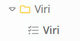
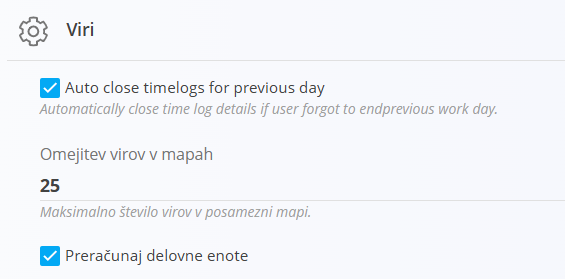

<!-- app_route: /management/configuration -->
<!-- app_label: Konfiguracija -->
<!-- canonical_source_url: https://tom-pit.github.io/Connected.Docs/sl/Domene/Sistem/Nastavitve/NastavitveVirov/ -->
<!-- canonical_source_title: Nastavitve virov -->

# Nastavitve virov

Razdelek **Viri** v konfiguraciji določa, kako so organizirane mape virov, kako sistem zapira delovni čas, ki je ostal odprt ob koncu dneva, kako se beleži plačana malica in kdo prejema prošnje za plačani dopust.

Do teh nastavitev pridete tako, da greste v **Sistem / Konfiguracija** in poiščete razdelek **Viri**. Nastavitve **Dnevnik prisotnosti** so v istem območju.

> [!WARNING]
> Te nastavitve vplivajo na procese dnevnika časa in dopustov za vse delavce. Spreminjati jih smejo samo sistemski skrbniki.

## Viri

### Auto close timelogs for previous day

Ko je ta nastavitev izbrana, sistem zapre odprt delovni čas ob koncu prejšnjega dne, ko se uporabnik naslednji dan prijavi. Nov delovni čas se nato začne.

<!-- TODO: Potrdite natančen čas zaključka z razvijalci. Test 18. novembra 2026 je delovni čas zaključil ob 22.59. -->

Za podjetja, ki delajo 24-urne izmene, odznačite to nastavitev. Delavec se lahko na primer prijavi ob 22.00 in gre na malico ob 0.31. Ko je nastavitev odznačena, sistem prejšnjega dne delovnega časa ne zapre, ko se uporabnik naslednji dan prijavi.

### Omejitev virov v mapah

Vnesite največje število virov, ki jih lahko vsebuje posamezna mapa.

## Dnevnik prisotnosti

### Prejemniki prošenj za dopust

Izberite uporabnike, ki prejmejo e-poštno sporočilo, ko je poslan obrazec za prošnjo za dopust, da lahko prošnjo odobrijo.

### Čas plačane malice

Vnesite največji čas malice v minutah, ki ga sistem beleži kot plačano malico za delavce. Malica, daljša od te vrednosti, se beleži kot zasebni čas in se ne šteje v delovne ure.

Na primer, pri **Čas plačane malice**, nastavljenem na 30 minut:

1. Delavec se odjavi na malico ob 12:00. Delovni čas se ustavi, malica se začne.
2. Delavec se ob 12:35 spet prijavi.
3. Sistem malico od 12:00 do 12:30 beleži kot plačano malico.
4. Preostalih 5 minut, od 12:30 do 12:35, se beleži kot zasebni čas in se ne šteje v delovne ure.
