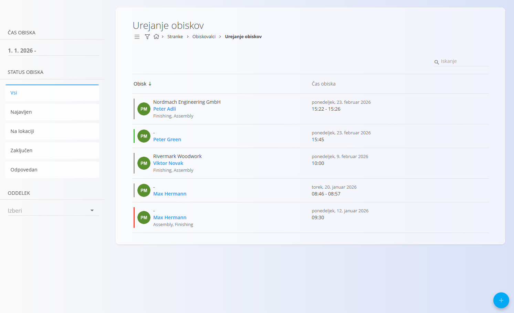
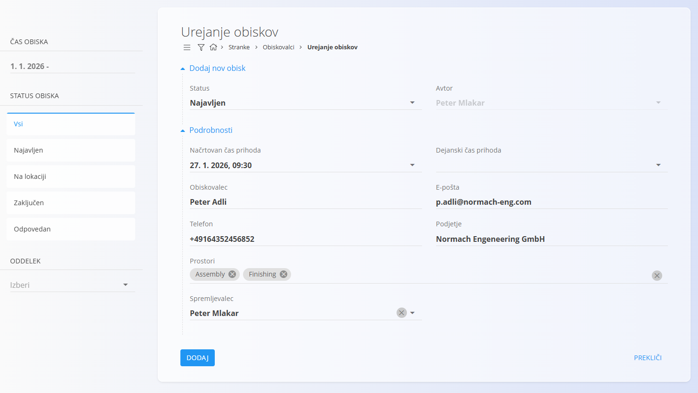
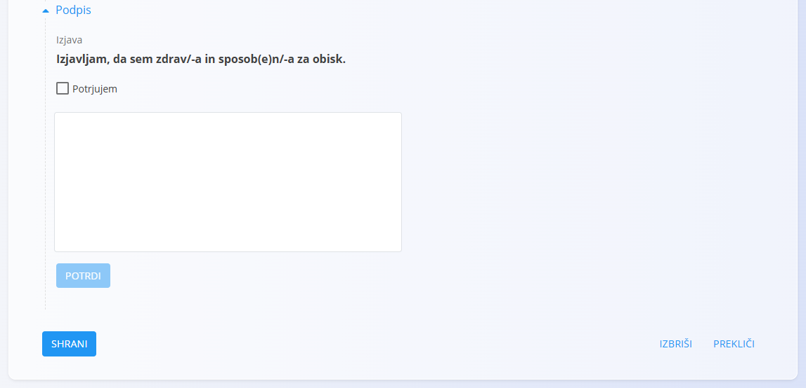
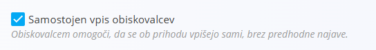
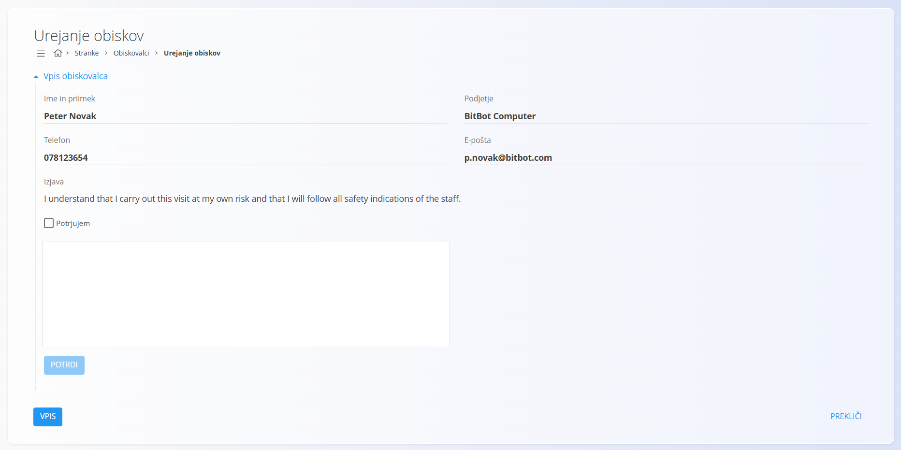

<!-- app_route: /customers/visitors/management -->
<!-- app_label: Urejanje obiskov -->
<!-- canonical_source_url: https://tom-pit.github.io/Connected.Docs/sl/Domene/Stranke/Obiskovalci/UrejanjeObiskov/ -->
<!-- canonical_source_title: Urejanje obiskov -->

# Urejanje obiskov

Zaslon **Urejanje obiskov** je namenjen ustvarjanju in spremljanju evidenc obiskov. Omogoča beleženje podatkov o obiskovalcih, načrtovanem in dejanskem času prihoda, statusu obiska ter prostorih in oddelkih, ki jih obiskovalec obišče.

Vsak obisk ima jasno določen življenjski cikel – od najave do zaključka ali odpovedi.

Za dostop do **Urejanja obiskov** pojdite na **Stranke / Obiskovalci / Urejanje obiskov** v [navigaciji](../../../Skupno/UI/Navigacija.md).

## Shema

| Polje | Opis |
|------|------|
| **Status** | Trenutni status obiska: *Najavljen*, *Na lokaciji*, *Zaključen* ali *Odpovedan* |
| **Avtor** | Uporabnik, ki je ustvaril zapis obiska |
| **Načrtovan čas prihoda** | Predviden datum in čas prihoda obiskovalca |
| **Dejanski čas prihoda** | Dejanski datum in čas prihoda obiskovalca |
| **Obiskovalec** | Ime in priimek obiskovalca (obvezno) |
| **E-pošta** | E-poštni naslov obiskovalca |
| **Telefon** | Telefonska številka obiskovalca |
| **Podjetje** | Podjetje, ki ga obiskovalec predstavlja |
| **Lokacije** | Lokacije obiska, prevzete iz šifranta [**Organizacijske enote**](../../Proizvodnja/Upravljanje/OrganizacijskeEnote.md). |
| **Spremljevalec** | Interna oseba, odgovorna za obiskovalca |
| **Podpis** | Izjava obiskovalca, potrditev in podpis, na voljo v načinu urejanja. Besedilo izjave je mogoče nastaviti v sistemski konfiguraciji. |

## Seznam in filtri

Seznamski pogled prikazuje vse zabeležene obiske in omogoča hitro filtriranje za lažje iskanje relevantnih vnosov.

V seznamu so obiski vizualno ločeni po barvah:

- Najavljen – modra  
- Na lokaciji – zelena  
- Zaključen – siva  
- Odpovedan – rdeča  

Razpoložljivi filtri:

- **Čas obiska**  
- **Status obiska**
  - Vsi
  - Najavljen
  - Na lokaciji
  - Zaključen
  - Odpovedan
- **Oddelek**

Vsaka vrstica prikazuje obiskovalca, podjetje, obiskane lokacije ter datum/čas obiska.

## Življenjski cikel in statusi obiska

Obisk prehaja skozi naslednje statuse:

- **Najavljen** – obisk je vnaprej načrtovan in zabeležen.
- **Na lokaciji** – obiskovalec je prispel na lokacijo.
- **Zaključen** – obisk je končan.
- **Odpovedan** – obisk je bil odpovedan in se ni izvedel.

## Ustvariti nov obisk

Nov obisk se ustvari, ko je načrtovan fizični obisk.

Tipičen potek:

1. Kliknite [akcijski gumb](../../../Skupno/UI/AkcijskiGumb.md) za ustvarjanje novega obiska.
2. **Status** je privzeto nastavljen na **Najavljen**.
3. Izpolnite podrobnosti obiska (polje **Obiskovalec** je obvezno).
4. Kliknite **Shrani**.

Obisk se prikaže v seznamu kot **Najavljen**.

## Upravljati obiska

### Prihod obiskovalca

Ko obiskovalec prispe na lokacijo:

1. Odprite zapis obiska.
2. Spremenite **Status** v **Na lokaciji**.
3. Zabeležite **Dejanski čas prihoda**.
4. Izpolnite izjavo obiskovalca in podpis v razdelku **Podpis** (glejte spodaj).
5. Kliknite **Shrani**.

Obisk se prikaže v seznamu kot **Na lokaciji**. Začne se beleženje trajanja obiska.

> [!NOTE]
> Vnos **Dejanskega časa prihoda** in izpolnitev razdelka **Podpis**, nato pa shranjevanje dokumenta, samodejno spremeni status v **Na lokaciji**.

#### Potrditev izjave in podpis

Pri odpiranju zapisa v načinu urejanja se prikaže razdelek **Podpis**.

Razdelek prikazuje izjavo obiskovalca, ki jo mora obiskovalec pred podpisom prebrati in potrditi.

Za potrditev:

1. Preberite **Izjavo**.
2. Označite **Potrjujem**.
3. Podpišite se v polju za podpis.
4. Kliknite **Potrdi**.

Besedilo, prikazano pod **Izjava**, je mogoče nastaviti v **Sistem / Nastavitve / Customers.Visitors / Customers.Visitors Settings**. V razdelku **Izjave ob obiskih** po potrebi uredite besedilo **Izjava za obiskovalce**.

### Zaključek obiska

Po koncu obiska:

1. Odprite zapis obiska.
2. Spremenite **Status** v **Zaključen**.
3. Kliknite **Shrani**.

S tem se konča beleženje trajanja obiska.  
Obisk se premakne med **Zaključene** in prikaže tako čas prihoda kot čas odhoda.

### Odpoved obiska

Če se načrtovan obisk ne izvede:

1. Odprite zapis obiska.
2. Nastavite **Status** na **Odpovedan**.
3. Kliknite **Shrani**.

Obisk se prikaže v stanju **Odpovedan** in je ustrezno označen v seznamu.

## Izbrisati obisk

Obiske je mogoče izbrisati, če so bili ustvarjeni pomotoma ali niso več potrebni.

Postopek:
1. Odprite zapis obiska.
2. Kliknite **Izbriši** in potrdite dejanje.

## Operativni pogled vhoda (način za tablico)

Poleg administrativnega pogleda sistem omogoča poenostavljen operativni pogled, namenjen uporabi na tablični napravi na vhodu. Odprete ga na naslovu `/customers/visitors/public-facing`.

> [!TIP]
> Pogled ni vključen v navigacijo ali zemljevid strani. Naslov si na tablici shranite kot zaznamek, da lahko pogled hitro odprete.

Ta pogled:

- Prikazuje samo današnje obiske v statusu **Najavljen** in **Na lokaciji**
- Ne vsebuje filtrov

Seznam se osveži, ko se obisk doda ali zaključi. Dodani obisk se prikaže na seznamu, zaključen obisk pa z njega izgine.

<!-- TODO: Potrdite, kako pogosto se pogled samodejno osvežuje. -->

Interakcija se nekoliko razlikuje od administrativnega pogleda:

- Obisk v statusu **Najavljen** je prikazan modro. Odprite ga, potrdite izjavo s podpisom in shranite. Status se spremeni v **Na lokaciji**, nastavi pa se dejanski čas prihoda.
- Obiska v statusu **Na lokaciji** v tem pogledu ni mogoče zaključiti. Status spremenite v **Zaključen** v pogledu za urejanje obiskov.
- Z gumbom **+** se lahko nenajavljen obiskovalec vpiše sam. Glejte [**Samostojen vpis obiskovalcev**](#samostojen-vpis-obiskovalcev).

### Samostojen vpis obiskovalcev

Obiskovalci, ki niso bili najavljeni, na primer serviserji, inšpekcija ali kupci, se lahko na vhodu vpišejo sami, brez pomoči recepcije.

Samostojen vpis je privzeto izklopljen. Vklopite ga v **Sistem / Konfiguracija**, v nastavitvah **Customers.Visitors Settings**, z možnostjo **Samostojen vpis obiskovalcev**.

<!-- TODO: Potrdite nazive skupine nastavitev in nastavitev Customers.Visitors Settings v slovenskem vmesniku. -->

Ko je vpis vklopljen, se na pogledu vhoda prikaže gumb **+**. Za vpis:

1. Izberite **+**.
2. Vnesite **Ime in priimek**. **Podjetje**, **Telefon** in **E-pošta** so neobvezni.
3. Preberite **Izjavo**, izberite **Potrjujem** in se podpišite v polje za podpis.
4. Izberite **Potrdi**.
5. Izberite **Vpis**.

Obisk se ustvari neposredno v statusu **Na lokaciji** z dejanskim časom prihoda. Dodatna potrditev ni potrebna. Najavljeni obiski se še vedno izbirajo s seznama.
