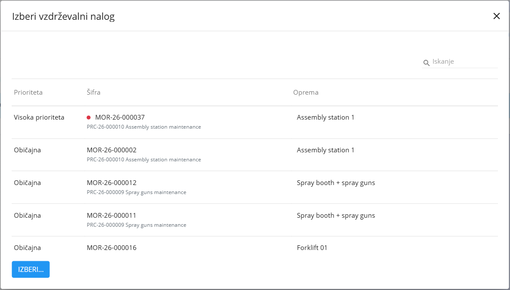
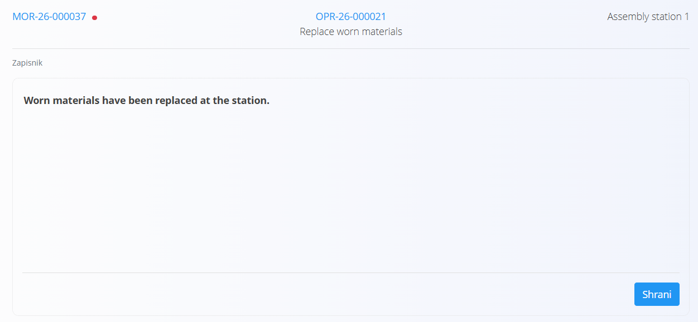

<!-- app_route: /maintenance-orders/execution -->
<!-- app_label: Vzdrževalni nalog – hitri uporabniški vodnik -->
<!-- canonical_source_url: https://github.com/Tom-PIT/Connected.Docs/blob/main/sl/Uvod/IzvedbaVzdrzevanjaHitriVodnik.md -->
<!-- canonical_source_title: Vzdrževalni nalog – hitri uporabniški vodnik -->

# Vzdrževalni nalog – hitri uporabniški vodnik

Ta vodnik prikazuje **osnovne korake** za izvajanje vzdrževalnih del na zaslonu Izvedba vzdrževanja.

> [!NOTE]
>
> Za več informacij in podrobnosti glejte celotno dokumentacijo [**Izvedba vzdrževanja**](../Domene/Vzdrzevanje/Dokumenti/IzvedbaVzdrzevanja.md).

## 1. Izberite vzdrževalni nalog

Ko odprete **Izvedba vzdrževanja**:
- preverite, ali je na vrhu zaslona izbrana pravilna organizacijska enota
- preverite, ali sta prikazana vzdrževalni nalog in operacija, s katerima boste delali

Za izbiro drugega vzdrževalnega naloga kliknite **vzdrževalni nalog** v zgornjem levem kotu. V pogovornem oknu izberite nalog (prikazuje se **Prioriteta**, **Šifra** in **Oprema**) in kliknite **Izberi**. Glejte [**Izbira vzdrževalnega naloga**](../Domene/Vzdrzevanje/Dokumenti/IzvedbaVzdrzevanja.md#izbira-vzdrzevalnega-naloga).

Če vzdrževalni nalog ni izbran ali pa nobeden ni na voljo, vas bo zaslon pozval k izbiri.

## 2. Začnite operacijo

Pritisnite **Začni**, da začnete trenutno operacijo. Operacija postane aktivna in začne se beležiti čas izvajanja. Glejte [**Začetek vzdrževanja**](../Domene/Vzdrzevanje/Dokumenti/IzvedbaVzdrzevanja.md#zacetek-vzdrzevanja).

Če morate delo prekiniti, pritisnite **Premor**. Operacija ostane odprta, nadaljujete pa jo s ponovnim pritiskom na **Začni**. Glejte [**Premor vzdrževanja**](../Domene/Vzdrzevanje/Dokumenti/IzvedbaVzdrzevanja.md#premor-vzdrzevanja).

## 3. Izpolnite kontrolne sezname (če so zahtevani)

[Kontrolni seznami kakovosti](../Domene/Proizvodnja/Dokumenti/Izvedba.md#kontrolne-liste-in-kvaliteta) so preproste, korak za korakom potekajoče preglede, ki pomagajo, da je delo varno in rezultat pravilen. Kontrolni seznam se lahko prikaže ob začetku, med premorom ali ob zaustavitvi operacije, odvisno od nastavitev operacije.

1. Upoštevajte korake, prikazane na zaslonu.
2. Dokončajte vsak korak. Ko ste končali, kliknite **Zaključi**.
3. Za pregled kontrolnih seznamov kadar koli odprite [akcijski gumb](../Skupno/UI/AkcijskiGumb.md) in izberite **Kvaliteta**. Glejte [**Kvaliteta**](../Domene/Vzdrzevanje/Dokumenti/IzvedbaVzdrzevanja.md#kvaliteta).

> [!NOTE]
> Operacije ne morete zaustaviti, dokler zahtevani kontrolni seznam ni dokončan.

## 4. Sledite navodilom (če so na voljo)

Če so za operacijo določena navodila, odprite [akcijski gumb](../Skupno/UI/AkcijskiGumb.md) in izberite **Navodila**. Glejte [**Navodila**](../Domene/Vzdrzevanje/Dokumenti/IzvedbaVzdrzevanja.md#navodila).

Pred začetkom dela jih preglejte in med delom uporabljajte kot vodilo. Lahko vsebujejo varnostna opozorila, korake ali vizualne prikaze.

## 5. Zabeležite porabljene materiale (če je potrebno)

To uporabite, kadar se med vzdrževanjem porabljajo materiali:

1. Odprite [akcijski gumb](../Skupno/UI/AkcijskiGumb.md) in izberite **Vhodi**. Glejte [**Vhodi**](../Domene/Vzdrzevanje/Dokumenti/IzvedbaVzdrzevanja.md#vhodi).
2. Izberite material.
3. Vnesite porabljeno količino.
4. Kliknite **Shrani**.

Zaslon prikazuje porabljeno količino v primerjavi s predvideno, na primer **0 / 3 kos**.

## 6. Zabeležite opravljeno delo

1. Odprite [akcijski gumb](../Skupno/UI/AkcijskiGumb.md) in izberite **Zapisnik**. Glejte [**Zapisnik**](../Domene/Vzdrzevanje/Dokumenti/IzvedbaVzdrzevanja.md#zapisnik).
2. V polje za prosti tekst vnesite opis opravljenega dela.
3. Kliknite **Shrani**.

Shranjeni zapisnik je prikazan tudi na vzdrževalnem nalogu.

## 7. Zabeležite delo (delovni čas)

1. Odprite [akcijski gumb](../Skupno/UI/AkcijskiGumb.md) in izberite **Delo**, če to zahteva vaš potek dela. Glejte [**Delo**](../Domene/Vzdrzevanje/Dokumenti/IzvedbaVzdrzevanja.md#delo).

### Trenutna aktivnost:

Pritisnite **Začni**, opravite delo, nato pritisnite **Ustavi**.

### Ročno:

Odprite **Delo** in vnesite:
- datum
- čas začetka in konca ali trajanje
- opombe (neobvezno)

Vnos shranite. Zabeleženo delo je prikazano na seznamu spodaj.

## 8. Zaključite operacijo

Ko je vse vzdrževalno delo končano:

1. Preverite, ali so kontrolni seznami zaključeni ter ali so materiali in delo zabeleženi.
2. Pritisnite **Ustavi**, da zaključite operacijo. Glejte [**Zaključek vzdrževanja**](../Domene/Vzdrzevanje/Dokumenti/IzvedbaVzdrzevanja.md#zakljucek-vzdrzevanja).

Operacija je označena kot **Zaključena**, zabeleži pa se tudi čas zaključka.

Ko ustavite zadnjo operacijo vzdrževalnega naloga, se nalog samodejno zaključi.

Vzdrževalni nalog lahko zaključite tudi iz samega naloga, ne da bi ustavili preostale operacije. Odprite meni v zgornjem desnem kotu vzdrževalnega naloga in v razdelku **Akcija** izberite **Zaključi vzdrževalni nalog**.

## 9. Ponovno aktivirajte zaključeno operacijo (če je potrebno)

Zaključene operacije ni mogoče ponovno aktivirati na zaslonu Izvedba vzdrževanja. Da jo ponovno odprete, odprite vzdrževalni nalog in pri operaciji izberite **Ponovno aktiviraj**. Glejte opombo v razdelku [**Zaključek vzdrževanja**](../Domene/Vzdrzevanje/Dokumenti/IzvedbaVzdrzevanja.md#zakljucek-vzdrzevanja).

## Povezani vodniki

- [**Izvedba – hitri uporabniški vodnik**](IzvedbaHitriVodnik.md)
